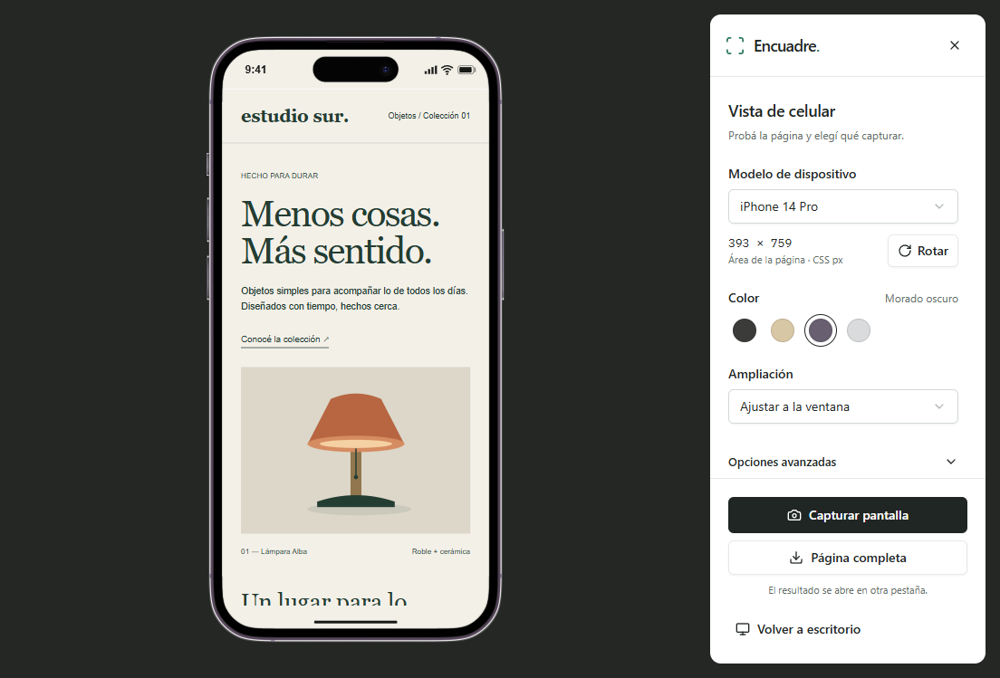
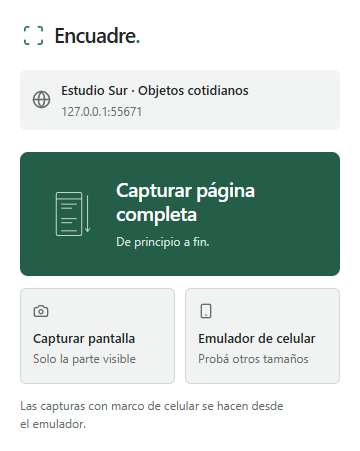
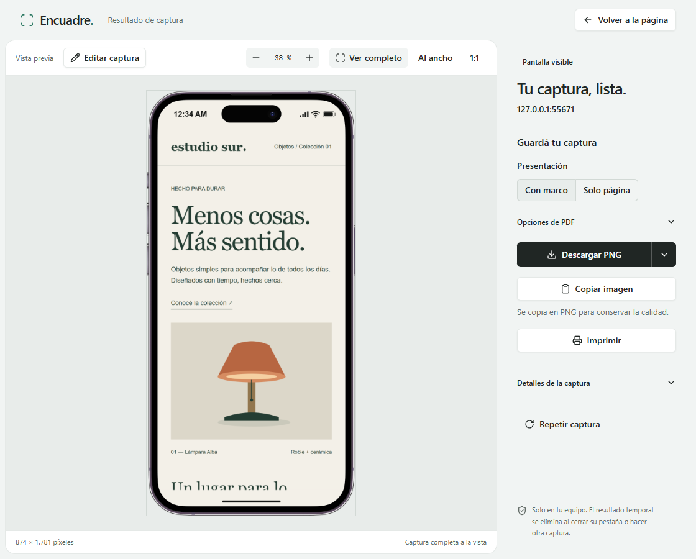
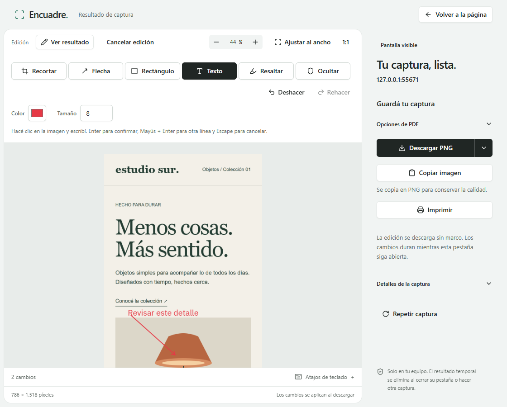

# Encuadre

**Capturas de página completa y vista de celular, desde Chrome.**

Probá tu web en distintos dispositivos, capturala con o sin marco y agregá anotaciones antes de compartirla. Sin cuenta, con procesamiento local e interfaz en español e inglés.

[Instalación](#instalación) · [Cómo se usa](#cómo-se-usa) · [Capturas](#capturas) · [Desarrollo](#desarrollo)



## Qué podés hacer

| Función | Qué permite |
| --- | --- |
| Captura completa o visible | Guardar todo el contenido vertical o solo lo que se ve en pantalla. |
| Vista de dispositivos | Probar modelos de iPhone, Galaxy, Pixel y iPad, rotarlos y cambiar su acabado. |
| Marcos de dispositivo | Exportar la captura visible con la carcasa del equipo o solo la página. |
| Editor integrado | Recortar, dibujar flechas, agregar texto, resaltar y ocultar información con bloques opacos. |
| Exportación | Descargar PNG, JPEG o PDF, copiar la imagen en PNG e imprimir. |

## Instalación

Se instala localmente como una extensión sin empaquetar. Requiere **Node.js 22.12 o superior**, npm y **Chrome 125 o superior**.

```sh
git clone https://github.com/FedericoLuna01/Encuadre.git
cd Encuadre
npm ci
npm run build
```

1. Abrí `chrome://extensions` y activá **Modo de desarrollador**.
2. Elegí **Cargar extensión sin empaquetar** y seleccioná la carpeta `dist` del repositorio.
3. Fijá Encuadre en la barra de extensiones y abrilo desde una página web.

Después de cambiar el código, ejecutá `npm run build` y recargá la extensión en Chrome.

## Cómo se usa

1. **Abrí Encuadre en la página que querés guardar.** Elegí **Capturar página completa** o **Capturar pantalla**. También podés usar el menú contextual o el atajo **Alt + Shift + S**, configurable en `chrome://extensions/shortcuts`.
2. **Para probar un celular, abrí el emulador.** Elegí el dispositivo y navegá dentro del teléfono. Desde sus controles podés rotarlo y capturar la pantalla con marco opcional, o la página completa sin marco. **Volver a escritorio** recupera la página original.
3. **Revisá y guardá el resultado.** Usá **Editar captura** para recortar y anotar. Las opciones junto a **Descargar PNG** permiten elegir JPEG o PDF. Las capturas editadas se exportan sin marco.

## Capturas

Las imágenes muestran la extensión en funcionamiento sobre «Estudio Sur», una página ficticia de demostración. Abrí cada vista para ver el detalle; hacé clic en la imagen para verla a tamaño completo.

<details>
<summary><strong>Menú de captura</strong> — página completa, pantalla visible y emulador</summary>

<p align="center">
  <a href="docs/screenshots/menu.png"></a>
</p>

</details>

<details>
<summary><strong>Resultado</strong> — vista previa, marco y opciones de descarga</summary>

[](docs/screenshots/resultado.png)

</details>

<details>
<summary><strong>Editor</strong> — recorte, anotaciones, resaltado y ocultado</summary>

[](docs/screenshots/editor.png)

</details>

## Privacidad y límites

Las imágenes se procesan **en tu equipo**, sin cuenta ni servicios externos. Encuadre conserva preferencias y un único resultado temporal, que otra captura reemplaza. Se elimina al cerrar su pestaña o reiniciar Chrome. Descargá el archivo para conservarlo.

- El emulador usa el motor de Chrome: no reproduce Safari ni sustituye un teléfono físico. Chrome muestra un aviso de depuración mientras está abierto.
- La vista móvil carga una instancia nueva del sitio. Conserva sus cambios al rotar o cambiar de modelo; al cerrarla vuelve a la página original.
- Las páginas internas de Chrome, la Chrome Web Store y los archivos locales no son compatibles. Las páginas infinitas y los paneles con desplazamiento propio pueden generar capturas parciales.
- El PDF contiene imágenes sin texto seleccionable. Las ediciones duran mientras siga abierta la pestaña del resultado.

Consultá la [política de privacidad](PRIVACIDAD.md), el [detalle de los permisos](docs/GUIA-TECNICA.md#permisos-y-datos) y los [límites completos](docs/GUIA-TECNICA.md#límites-conocidos).

## Desarrollo

Hecha con **React, TypeScript, Tailwind CSS y shadcn/ui sobre Radix**, sobre Manifest V3.

| Comando | Uso |
| --- | --- |
| `npm run dev` | Vista previa de la interfaz. Las capturas requieren la extensión instalada. |
| `npm run build` | Comprobación de tipos y compilación en `dist/`. |
| `npm run typecheck` | Comprobación de tipos de TypeScript. |
| `npm test` | Pruebas unitarias. |
| `npm run test:all` | Compilación y pruebas unitarias y de navegador. |

Para las pruebas de navegador, instalá Chromium con `npx playwright install chromium`. La [guía técnica](docs/GUIA-TECNICA.md#desarrollo-y-verificación) detalla la arquitectura, las suites y cómo reutilizar un servidor de desarrollo.

## Documentación

[Guía técnica](docs/GUIA-TECNICA.md) · [Funcionalidades](FUNCIONALIDADES.md) · [Catálogo de iPhone](IPHONE-MOCKUPS.md) · [Créditos de los marcos](FRAME-CREDITS.md) · [Ficha para la tienda](FICHA-TIENDA.md)
